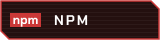

<!-- HERO CARD -->
<picture>
  <source media="(max-width: 600px)" srcset="assets/hero-phone.svg">
  
</picture>

  

<!-- DESCRIPTION -->
<picture>
  <source media="(max-width: 600px)" srcset="assets/section-description-phone.svg">
  
</picture>

My main focus is on working with **APIs**, **Websites**, and **Mobile Apps**.
I'm currently studying **Machine Learning**, and I pursue **Game Development** as a personal hobby.

<!-- SOCIAL -->
<picture>
  <source media="(max-width: 600px)" srcset="assets/section-social-phone.svg">
  
</picture>

